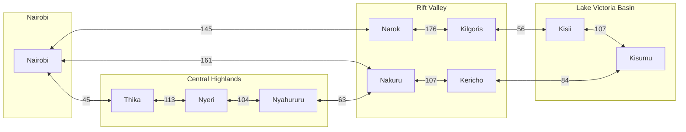
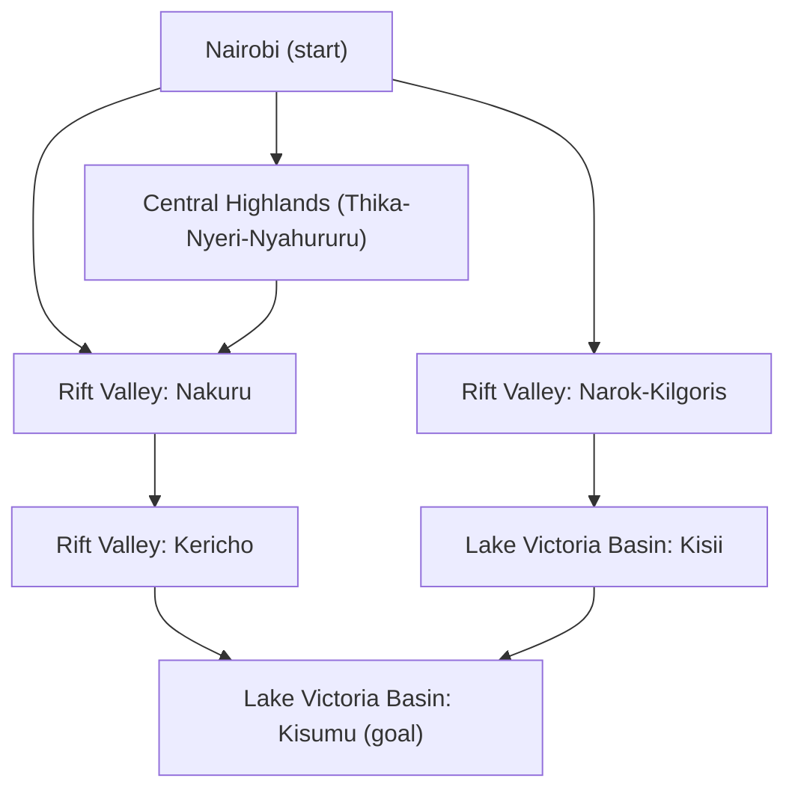
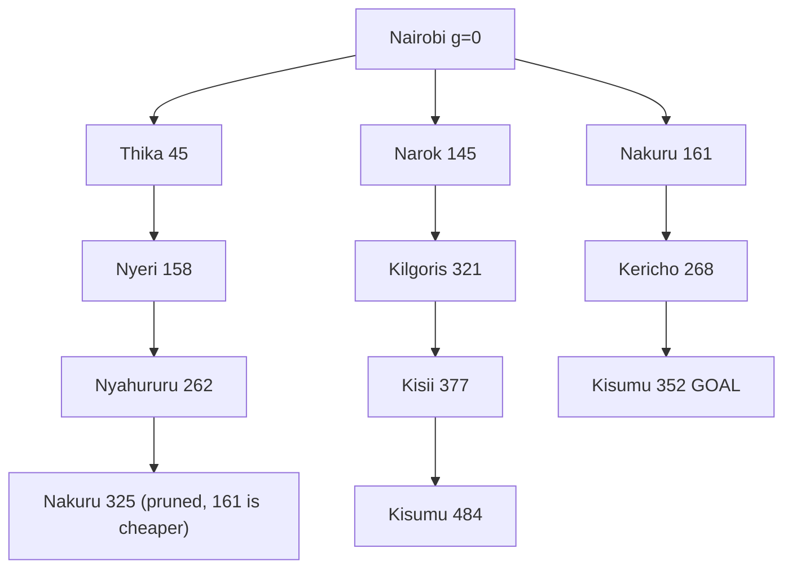

# ICS 3202: Practical Exercise 3 - Designing a Searching Agent
* 172651 - Abdilatif Ramadhan
* 191252 - Adam Etyang
* 189723 - Eleanor Linda Opolo

## 1. Agent Design & Environment Analysis

### PEAS Framework
* Performance Measure: Minimum distance traveled, travel time, and fuel consumption. No accidents, no violations of traffic laws, minimum wear and tear of the vehicle, and ensuring that the cargo gets to Kisumu safely.
* Environment: The national highway network of Kenya, linking Nairobi, Central Highlands, Rift Valley, and Lake Victoria Basin areas. The roads include one-lane and two-lane roads; varying road surfaces; traffic; weather variables; speed bumps; pedestrian and animal traffic.
* Actuators: Steering rack motor, gas pedal/throttle motor, braking system, gear shifting system, signal lamps/indicators, headlights, and the horn.
* Sensors: GPS, Cameras/Radar/LiDAR, speedometer, wheel encoder, fuel level sensor, and orientation sensors.

### Properties of the Environment
* Partially Observable: The truck does not have information about the whole route and road conditions of the whole country at any one time; it can see only as far as its own sensors (cameras/RADAR) allow.
* Stochastic: The road environment is not deterministic; random events such as traffic delays, weather conditions, other vehicles making sudden braking maneuvers, and animals on the road mean that the future state will not necessarily be determined by the present state.
* Sequential: Early choices impact later ones. Deciding to turn at a specific junction determines which subsequent towns are accessible and affects overall fuel and distance later in the journey.
* Dynamic: Traffic flow, weather, and road conditions change continuously while the trailer agent is calculating or executing a route.
* Continuous: Speed, steering angles, acceleration, and location coordinates change along continuous numerical ranges rather than distinct steps.

---

## 2. Directed Graph and Search Tree

### Directed Graph
(Each road is two-way, so each edge is a pair of directed arcs)

### Search Tree with Abstraction

Level 1: Abstract tree (regions as super-states)

Level 2: Refined tree (towns, cumulative path cost g in km; repeated states pruned)

---

## 3. Determining the Optimal Path from Nairobi to Kisumu

### Path Cost
The path cost is the total distance travelled along a route. Compare total distances to find shortest route.

### Route A: Via Nakuru and Kericho
Path: Nairobi to Nakuru to Kericho to Kisumu  
* Nairobi to Nakuru = 161 km  
* Nakuru to Kericho = 107 km  
* Kericho to Kisumu = 84 km  
Total distance: 161 + 107 + 84 = 352 km

### Route B: Via Narok, Kilgoris and Kisii
Path: Nairobi to Narok to Kilgoris to Kisii to Kisumu  
* Nairobi to Narok = 145 km  
* Narok to Kilgoris = 176 km  
* Kilgoris to Kisii = 56 km  
* Kisii to Kisumu = 107 km  
Total distance: 145 + 176 + 56 + 107 = 484 km

### Route C: Via Thika, Nyeri, Nyahururu, Nakuru and Kericho
Path: Nairobi to Thika to Nyeri to Nyahururu to Nakuru to Kericho to Kisumu  
* Nairobi to Thika = 45 km  
* Thika to Nyeri = 113 km  
* Nyeri to Nyahururu = 104 km  
* Nyahururu to Nakuru = 63 km  
* Nakuru to Kericho = 107 km  
* Kericho to Kisumu = 84 km  
Total distance: 45 + 113 + 104 + 63 + 107 + 84 = 516 km

### Comparison of the Routes
* Route A: Via Nakuru and Kericho = 352 km
* Route B: Via Narok, Kilgoris and Kisii = 484 km
* Route C: Via Thika, Nyeri, Nyahururu, Nakuru and Kericho = 516 km

### Optimal Path
From the three routes compared, Route A has the lowest total distance.

* Optimal path: Nairobi to Nakuru to Kericho to Kisumu
* Total distance: 161 + 107 + 84 = 352 km

